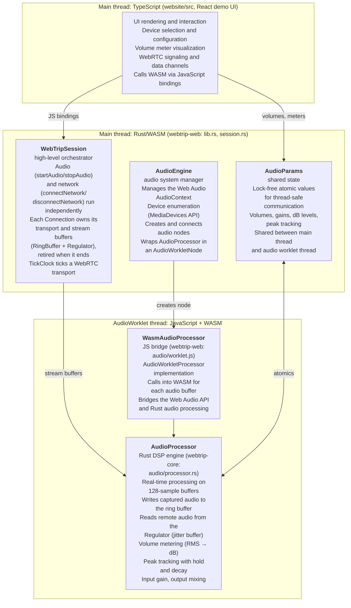
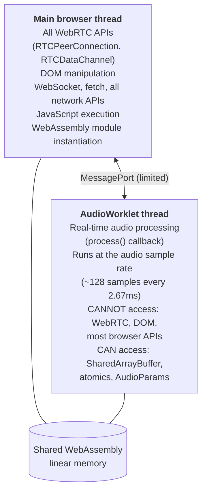
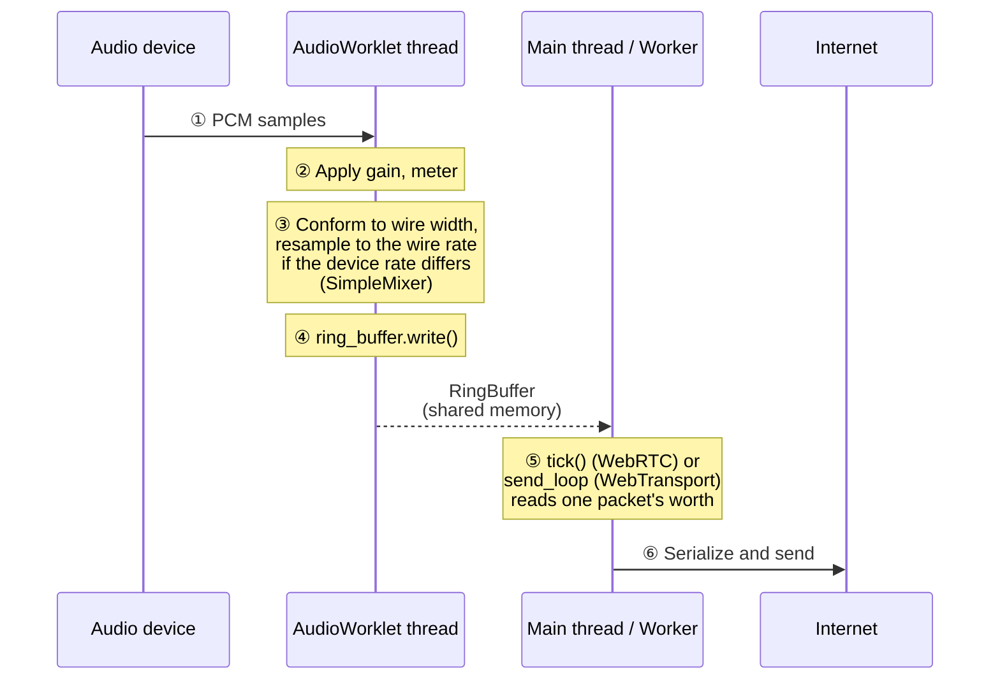
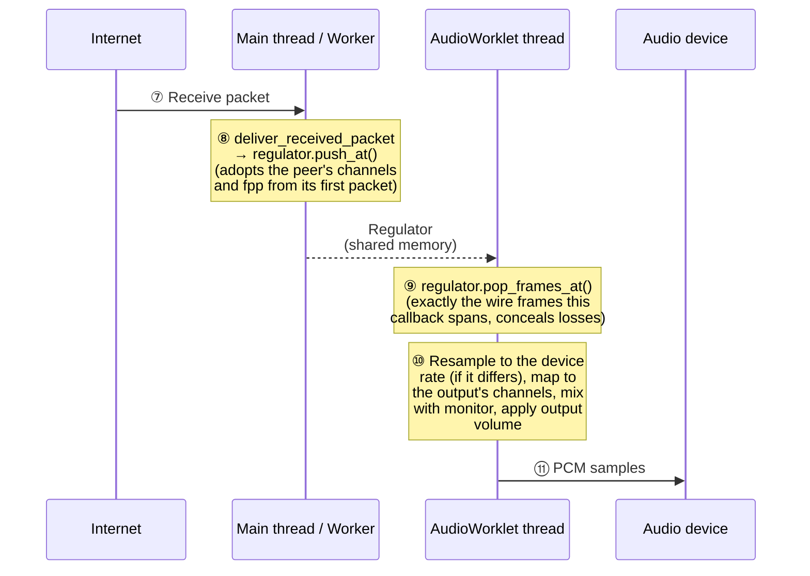
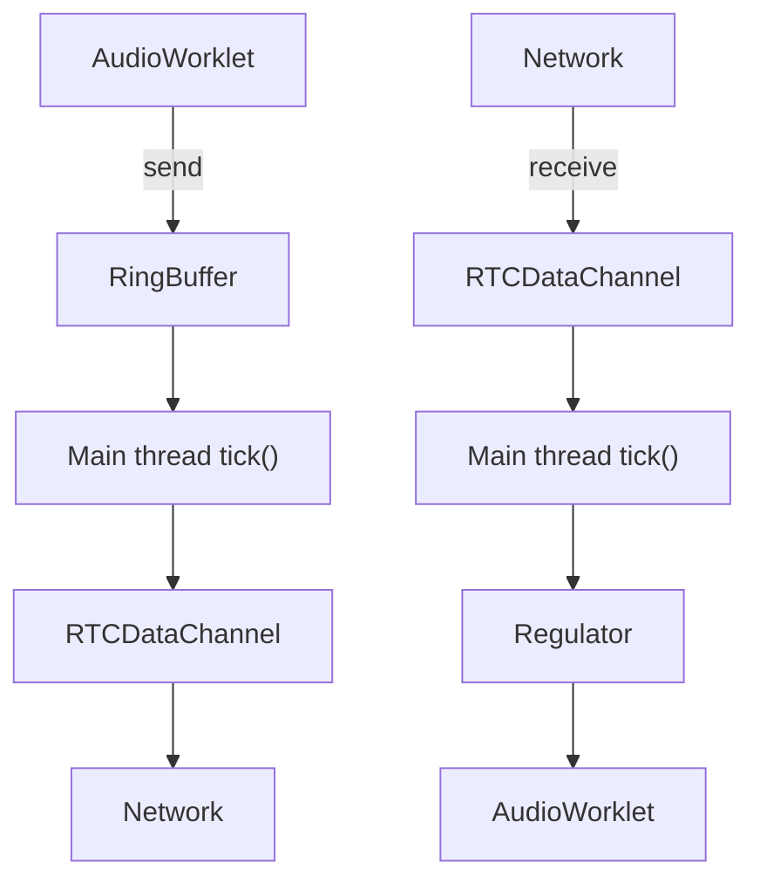
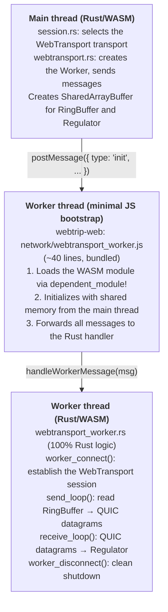

# WebTrip WebAssembly Architecture

This document explains the architecture of WebTrip, including how we work around browser API limitations to achieve low-latency, real-time audio streaming.

---

## Table of Contents

1. [High-Level Overview](#high-level-overview)
   - [Crate Layout](#crate-layout)
2. [Why This Architecture?](#why-this-architecture)
3. [Threading Model](#threading-model)
4. [Limitation 1: WebRTC on Main Thread Only](#limitation-1-webrtc-on-main-thread-only)
5. [Limitation 2: AudioWorklet Thread Isolation](#limitation-2-audioworklet-thread-isolation)
6. [Limitation 3: No Direct Thread Communication](#limitation-3-no-direct-thread-communication)
7. [Workaround: Connection-Owned Buffers](#workaround-connection-owned-buffers-with-shared-pointers)
8. [Workaround: Tick Clock](#workaround-tick-clock)
9. [Complete Data Flow](#complete-data-flow)
10. [Trade-offs and Alternatives](#trade-offs-and-alternatives)

---

## High-Level Overview

WebTrip uses a multi-threaded architecture with WebAssembly for high-performance audio processing:



### Component Summary

- **Frontend Layer** (`website/src/pages/demo/`): React demo UI that manages user interactions, device selection, and WebRTC signaling
- **Session Layer** (`crates/web/src/session.rs`, `connection.rs`, `tick_clock.rs`): Orchestrates network and audio; each connection owns its transport and stream buffers
- **Mixer** (`crates/core/src/audio/mixer.rs`): `MixEngine`/`SimpleMixer`, the device↔network mix, including sample-rate conversion when the device rate differs from the 48 kHz wire rate
- **Audio Engine** (`crates/web/src/audio/engine.rs`): Manages Web Audio API, creates AudioContext and worklet nodes
- **Audio Processor** (`crates/core/src/audio/processor.rs`): Real-time DSP processing in dedicated audio thread

### Key Data Structures

- **RingBuffer**: Lock-free SPSC queue for local audio capture (AudioWorklet → transport); also carries the connection's send width
- **Regulator**: Lock-free SPSC jitter buffer with Burg packet-loss concealment for network audio (transport → AudioWorklet). Adopts the peer's channel count and frames-per-packet from its first packet, and serves the audio callback a frame at a time, so callback size and packet size are independent
- **AudioParams**: Atomic values for sharing device and metering state (volumes, gains, peaks) between threads

## Crate Layout

A Cargo workspace of four crates. Portable logic and its browser host are separate crates, and the split is compiler-enforced: `npm run check:core` builds every crate but `webtrip-web` natively, and fails if one reaches `web-sys`/`js-sys`.

| Crate | Directory | Contents |
|---|---|---|
| `webtrip-core` | `crates/core` | Portable: `limits.rs`, `audio/` (processor, params, dsp, mixer), `network/` (protocol, transport trait, signaling messages), `stream/` (shared_ptr, ring_buffer, regulator), `lifecycle.rs`, `session_stats.rs` |
| `webtrip-api` | `crates/api` | Portable: the JackTrip Virtual Studio REST client and models |
| `webtrip-web` | `crates/web` | The browser host, built as `pkg/webtrip.js`: `audio/` (devices, engine, worklet), `network/` (webrtc, webtransport, signaling), `session.rs`, `connection.rs`, `tick_clock.rs` |
| `webtrip` | `crates/webtrip` | Facade: re-exports `webtrip::core`, `webtrip::api`, and `webtrip::web` behind the off-by-default `web` feature |

Within each crate, `network` never imports `audio` and `audio` never imports `network` (both may use `stream`); `session.rs` composes them. Core never reads a clock or a console: it logs through `log` (the web crate installs a console backend) and takes `now_ms` from its caller. JS exports on portable types are `#[cfg_attr(feature = "wasm", wasm_bindgen)]`, which only `webtrip-web` turns on, so the crate layout is invisible from TypeScript.

---

## Why This Architecture?

- **Performance**: Audio processing in Rust/WASM on dedicated audio thread with zero-copy shared memory
- **Thread Safety**: Lock-free atomics for communication without blocking real-time audio
- **Separation of Concerns**: UI, orchestration, network I/O, and DSP are cleanly separated
- **Extensibility**: Easy to add new audio effects or analysis features to `AudioProcessor`
- **Web Standards**: Uses Web Audio API best practices (AudioWorklet for low-latency)
- **Real-time Guarantees**: Audio thread never blocks on network I/O or UI updates

---

## Browser API Limitations and Workarounds

The following sections explain the constraints imposed by browser APIs and how we work around them.

---

## Threading Model

The browser provides multiple execution contexts with strict boundaries:



---

## Limitation 1: WebRTC on Main Thread Only

### The Problem

**WebRTC APIs are only available on the main browser thread.**

```javascript
// ✅ Main thread - works
const dataChannel = peerConnection.createDataChannel("audio");
dataChannel.send(audioData);

// ❌ AudioWorklet thread - DOES NOT WORK
// RTCDataChannel is undefined in worklet scope
class MyProcessor extends AudioWorkletProcessor {
  process(inputs, outputs) {
    // Can't call dataChannel.send() here!
    // Can't access any WebRTC APIs!
  }
}
```

### Why This Matters

For real-time audio streaming, we need to:
- **Capture audio** in the AudioWorklet (low latency)
- **Send audio** over WebRTC data channel (main thread only)
- **Receive audio** from WebRTC data channel (main thread only)
- **Play audio** in the AudioWorklet (low latency)

The audio processing and network I/O happen in **different threads**.

---

## Limitation 2: AudioWorklet Thread Isolation

### The Problem

**The AudioWorklet thread cannot access most JavaScript objects.**

What you **CAN** pass to AudioWorklet:
- Numbers (pointers, IDs)
- TypedArrays (Float32Array, Uint8Array, etc.)
- SharedArrayBuffer
- AudioParams
- Serializable objects via MessagePort

What you **CANNOT** pass:
- WebRTC objects (RTCDataChannel, RTCPeerConnection)
- DOM elements
- Functions/closures
- Arbitrary Rust structs
- Most JavaScript objects

### Example

```rust
// ❌ Cannot do this
struct AudioProcessor {
    data_channel: RTCDataChannel,  // Can't pass WebRTC object to worklet!
}

// ✅ Must do this instead
struct AudioProcessor {
    buffer_ptr: *mut RingBuffer,  // Just a number (memory address)
}
```

---

## Limitation 3: No Direct Thread Communication

### The Problem

**AudioWorklet and main thread cannot directly call each other's functions.**

Communication options are extremely limited:
1. **MessagePort**: Async message passing (too slow for real-time audio)
2. **SharedArrayBuffer + Atomics**: Shared memory (manual synchronization)
3. **AudioParams**: Float values only (very limited)

### Why MessagePort Doesn't Work

```javascript
// Main thread
workletNode.port.postMessage({ audio: samples });

// AudioWorklet receives messages ASYNCHRONOUSLY
class MyProcessor extends AudioWorkletProcessor {
  constructor() {
    this.port.onmessage = (e) => {
      // ❌ This callback doesn't run during process()!
      // ❌ It runs between process() calls - unpredictable timing!
    };
  }
  
  process() {
    // Need audio data NOW, can't wait for async message
  }
}
```

For real-time audio (~2.7ms intervals at 128 samples/48kHz), we need **synchronous, deterministic access** to shared data.

---

## Audio and network are independent

`WebTripSession` runs the audio engine and the network connection independently:

- `startAudio()` / `stopAudio()` bring the engine up and down (`getAudioState()`: `"stopped"` / `"running"`). With no connection the worklet monitors the input and plays nothing back.
- `connectNetwork()` / `disconnectNetwork()` dial and end a hub connection (`getState()`). With no engine, the connection still receives and sends nothing.
- `connect()` is `startAudio` then `connectNetwork`, and owns the audio it started: `disconnect()` (or a failed connect) stops it. Audio already running when it is called is left alone. `disconnectNetwork()` ends the connection but leaves audio running, and hands it to the caller.

Each connection has its own `RingBuffer` and `Regulator`. A worklet node's stream list is fixed for its life, so attaching or detaching a connection while audio runs rebuilds the node (the brief glitch an output-device change causes), and the ended connection's buffers are *retired*: freed once the replaced node posts `"stopped"`, or once its engine's `AudioContext.close` fulfils.

A WebRTC transport is ticked by `TickClock`: from the audio callback (`Atomics.waitAsync` on the send ring's flag) while audio runs, and on a fixed interval otherwise, because only the worklet sets that flag. WebTransport's worker drives itself and needs no clock.

## Workaround: Connection-Owned Buffers with Shared Pointers

### The Solution

**Each connection owns its stream buffers** (main thread), and **the other agents reach them through pointers** into the shared WebAssembly linear memory. No global statics are involved: linear memory is shared by every agent in the module instance, so all that matters is that the buffers stay alive, and at a fixed address, while anyone can still touch them.

```rust
// crates/web/src/connection.rs
pub(crate) struct StreamBuffers {
    pub(crate) ring: Box<RingBuffer>,       // worklet → transport
    pub(crate) regulator: Box<Regulator>,   // transport → worklet
}
```

`StreamBuffers::new` is the one allocation site. It declares the send width on the ring (`RingBuffer::set_wire_format`) and builds the regulator at the configured receive geometry, sized for the largest callback and packet it may ever serve, so nothing allocates on the render thread. The boxes keep the addresses stable.

### How It Works

1. **Connecting builds a fresh `StreamBuffers`**, never a reused one, so the regulator stays strictly single-producer/single-consumer with no reset protocol. A reconnect adopts the new peer's channel count and frames-per-packet simply by starting from a fresh regulator.
2. **The pointers cross agents as `SharedPtr`** (`crates/core/src/stream/shared_ptr.rs`), which carries the `Send`/`Sync` assertion once, in an audited place. The transport gets them for its send and receive paths (for WebTransport, its worker).
3. **The worklet node is built against them.** A node's stream list is fixed for its life: `AudioEngine::attach_network(ring, regulator)` rebuilds the node to attach or (with null pointers) detach a connection, the same path an output-device change uses. With no connection, the processor runs with no network streams and just monitors the input.
4. **Both sides then use the buffers' `&self` lock-free APIs:** the worklet writes the ring and pops the regulator, and the transport reads the ring and pushes the regulator.

### Lifetime Management: Retirement

**The buffers must outlive every pointer to them.** When a connection ends, the transport is closed first, which quiesces the producer. The node is then rebuilt without the connection, and the connection's buffers are **retired**, not freed:

- `worklet.js`'s `'stop'` handler runs on the render thread, where it cannot overlap `process()`. It sets a flag that `process()` checks before touching any pointer, and posts `'stopped'` back. Receiving that acknowledgement on the main thread proves the replaced node will never touch the buffers again, so the retired entry is freed then.
- A fulfilled `AudioContext.close` (`stopAudio`, or the session's `Drop`) also frees the entries its own engine's nodes read.
- If neither proof ever arrives (for example, the close times out), the entry stays alive. It is leaked rather than freed under a possibly live reader, and the leak is bounded to one buffer pair per missing acknowledgement.

### Why Not Global Statics?

Global statics would mean global mutable state, unclear ownership, and a single stream per page. Per-connection buffers have one owner with a defined lifetime, and they are the groundwork for more than one connection (`limits::MAX_CONNECTIONS`, currently 1).

---

## Workaround: Tick Clock

### The Problem

WebRTC APIs exist only on the main thread, and the AudioWorklet cannot call them. Something on the main thread has to move audio between the send ring, the data channel and the regulator: that is `Transport::tick`.

### The Solution

The session owns a `TickClock` (`crates/web/src/tick_clock.rs`) that ticks the published connection's transport:

- **While audio runs: `Atomics`.** An `AudioCallbackLoop` sleeps with `Atomics.waitAsync` on the send ring's has-data flag, which `RingBuffer::write` sets from the worklet, so the transport ticks once per audio callback.
- **While audio is stopped: `Interval`.** Only the worklet sets that flag, so with no audio nothing would ever tick, and a WebRTC connection could not even receive. An `IntervalTickLoop` ticks every `INTERVAL_TICK_PERIOD_MS` (4 ms) instead. It is also the fallback when `Atomics.waitAsync` is unavailable.
- **WebTransport: none.** Its worker drives its own send and receive loops.

The pure choice is `tick_kind(audio_running, connection_needs_tick, atomics_available)`. The clock is rebuilt whenever audio starts or stops or the connection changes. Each loop stops itself when dropped.

### Why Can't AudioWorklet Call tick()?

`RTCDataChannel` does not exist in the AudioWorklet global scope, and network I/O must never block the render thread. The worklet therefore only writes the ring and pops the regulator, and the main thread (or the WebTransport worker) does all network I/O.

---

## Complete Data Flow

### Send Path: Microphone → Network



### Receive Path: Network → Speakers



### Key Points

- **Steps ①-④ and ⑨-⑪** happen in real time in `AudioWorklet.process()` (one 128-frame render quantum per call).
- **Steps ⑤-⑥** happen when the tick clock fires (WebRTC) or in the worker's send loop (WebTransport).
- **Steps ⑦-⑧** happen asynchronously when packets arrive.
- **RingBuffer** decouples the worklet's write rate from the network send rate.
- **Regulator** decouples the network receive rate, and the peer's packet size, from the audio callback.

---

## Transport Implementations

WebTrip supports two transport mechanisms for streaming audio packets: **WebRTC Data Channels** (main thread) and **WebTransport** (dedicated worker thread). Both share the same buffer infrastructure but differ in their threading model and browser support.

### WebRTC Transport

The WebRTC transport runs on the main thread using RTCDataChannel:



**Pros:**
- ✅ Universal browser support (Chrome, Firefox, Safari, Edge)
- ✅ Works with existing JackTrip infrastructure
- ✅ Battle-tested and stable

**Cons:**
- ⚠️ Network I/O blocks main thread (can affect UI responsiveness)
- ⚠️ Requires the main-thread tick clock (once per audio callback, or every 4 ms with audio stopped)
- ⚠️ More complex setup (SDP negotiation, ICE candidates)

### WebTransport Worker

The WebTransport transport offloads network I/O to a dedicated Web Worker:



**Pros:**
- ✅ Network I/O on dedicated worker thread (main thread stays responsive)
- ✅ Event-driven (no polling, uses QUIC async API)
- ✅ Lower latency (QUIC avoids head-of-line blocking)
- ✅ Simpler connection setup (no SDP/ICE negotiation)
- ✅ All logic in Rust (type-safe, zero-copy buffer access)

**Cons:**
- ❌ Needs newer browsers than WebRTC (see [browser support](browser-support.md))
- ⚠️ Requires minimal JavaScript bootstrap (~40 lines)

**Why JavaScript Glue is Needed:**

Web Workers must be created from a JavaScript file—browsers don't support loading WASM directly as workers. The JavaScript bootstrap:
- Imports the WASM glue from its own `import.meta.url`, via the header `dependent_module!` prepends to the Blob
- Initializes it with SharedArrayBuffer memory from the main thread
- Forwards all messages to Rust's `handleWorkerMessage()` function

This follows the **same pattern as AudioWorklet** (`crates/web/src/audio/worklet.js`):
- Both use the `dependent_module!` macro to bundle JS into the WASM package as Blob URLs
- Minimal JavaScript (~40-50 lines) acts as browser-mandated entry point
- All actual logic executes in Rust for type safety and performance
- The worklet bridge lives in `crates/web/src/audio/` and the worker bridge in `crates/web/src/network/`

**JavaScript (~40 lines):** Module loading, memory initialization, message forwarding  
**Rust (400+ lines):** Protocol logic, packet processing, buffer management, state tracking, statistics

**Note:** If browser vendors eventually add direct WASM worker support (e.g., `new Worker(url, { type: 'wasm', memory })`), the JavaScript bootstrap could be eliminated entirely.

---

## Trade-offs and Alternatives

### Current Approach: Connection-Owned Buffers + Tick Clock

**Pros:**
- ✅ Works within browser constraints
- ✅ Type-safe Rust abstractions over shared memory
- ✅ Lock-free atomics for performance
- ✅ Predictable real-time behavior in AudioWorklet
- ✅ Clear ownership and lifetime management
- ✅ Standard Rust RAII patterns
- ✅ Groundwork for more than one connection

**Cons:**
- ⚠️ Buffers are freed only on proof the worklet let go of them (retirement); without that proof they are leaked rather than freed
- ⚠️ Raw pointers at agent boundaries (confined to `SharedPtr`)
- ⚠️ Attaching or detaching a connection while audio runs rebuilds the worklet node (a brief glitch)
- ❌ With audio stopped, a WebRTC connection is ticked on a timer, which adds main-thread wakeups

### Alternative 1: Manual SharedArrayBuffer

Use `SharedArrayBuffer` directly from JavaScript:

**Pros:**
- No Rust global statics

**Cons:**
- Lose Rust type safety
- Manual atomic operations in JavaScript
- More complex, error-prone code
- Still need a main-thread tick

### Alternative 2: AudioWorkletProcessor MessagePort

Use MessagePort for communication:

**Pros:**
- No shared memory needed
- No global statics

**Cons:**
- ❌ **Asynchronous**: Messages don't arrive during process()
- ❌ **Unpredictable timing**: Can't guarantee real-time behavior
- ❌ **Fundamental limitation**: Still can't call WebRTC from worklet
- Still need a main-thread tick

**Note:** WebTrip uses the worklet's MessagePort only for lifecycle messages (`'stop'` / `'stopped'`, the retirement proof), never for audio data or tick notification.

### Alternative 3: Redesigned WebRTC API

What we'd ideally want:

```javascript
// Hypothetical future API (doesn't exist)
class AudioWorkletProcessor {
  process(inputs, outputs) {
    // ❌ This doesn't work and likely never will
    this.dataChannel.send(outputs[0][0]);
  }
}
```

**Reality**: Browser security model keeps threads isolated. WebRTC will likely **never** be available in AudioWorklet.

---

## Conclusion

The current architecture uses:

1. **Connection-owned buffers** - Allocated in WebAssembly linear memory per connection, accessed by other agents via `SharedPtr`
2. **Main-thread tick clock** - Required because WebRTC APIs only work on the main thread
3. **Lock-free ring buffers** - Efficient, wait-free communication without blocking
4. **Regulator (jitter buffer) with atomics** - Thread-safe packet reordering and loss concealment
5. **Retirement** - A connection's buffers are freed only after the worklet acknowledges `'stopped'` or its `AudioContext` closes
6. **Event notification with fallback** - Ticks from `Atomics.waitAsync()` when available, and on a 4 ms interval otherwise

These are **not design choices** but **necessary workarounds** for fundamental browser API limitations. Until browsers provide:
- WebRTC access from AudioWorklet, or
- Synchronous cross-thread communication, or  
- AudioWorklet access to network APIs

...we're stuck with this architecture.

### SharedArrayBuffer Requirement

**Important:** SharedArrayBuffer is **absolutely required** for WebTrip to function. The interval fallback in point #6 above only affects *when the transport ticks*, not the underlying buffer access. Both modes require:
- WASM linear memory backed by SharedArrayBuffer
- Atomic operations for thread-safe buffer synchronization
- Cross-origin isolation (COOP/COEP headers)

The interval fallback covers browsers where SharedArrayBuffer is available but `Atomics.waitAsync()` is not (for example Safari 15.2-16.3, Dec 2021 - Mar 2023).

The good news: It works well! The use of atomics ensures:
- **Lock-free**: No blocking in the real-time audio thread
- **Wait-free**: AudioWorklet.process() always completes quickly
- **Thread-safe**: No race conditions or data corruption

---

## Related Reading

- [AudioWorklet Design Pattern](https://developers.google.com/web/updates/2017/12/audio-worklet-design-pattern)
- [SharedArrayBuffer and Atomics](https://developer.mozilla.org/en-US/docs/Web/JavaScript/Reference/Global_Objects/SharedArrayBuffer)
- [WebRTC Data Channels](https://developer.mozilla.org/en-US/docs/Web/API/RTCDataChannel)
- [WebAssembly Threading](https://web.dev/webassembly-threads/)

