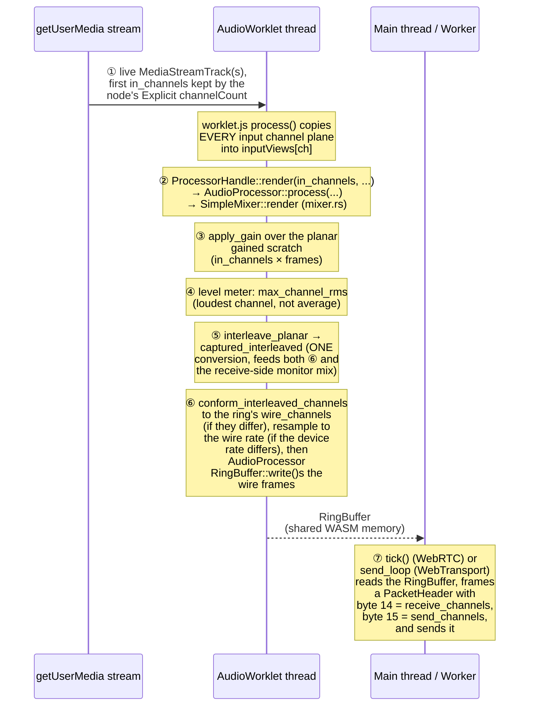
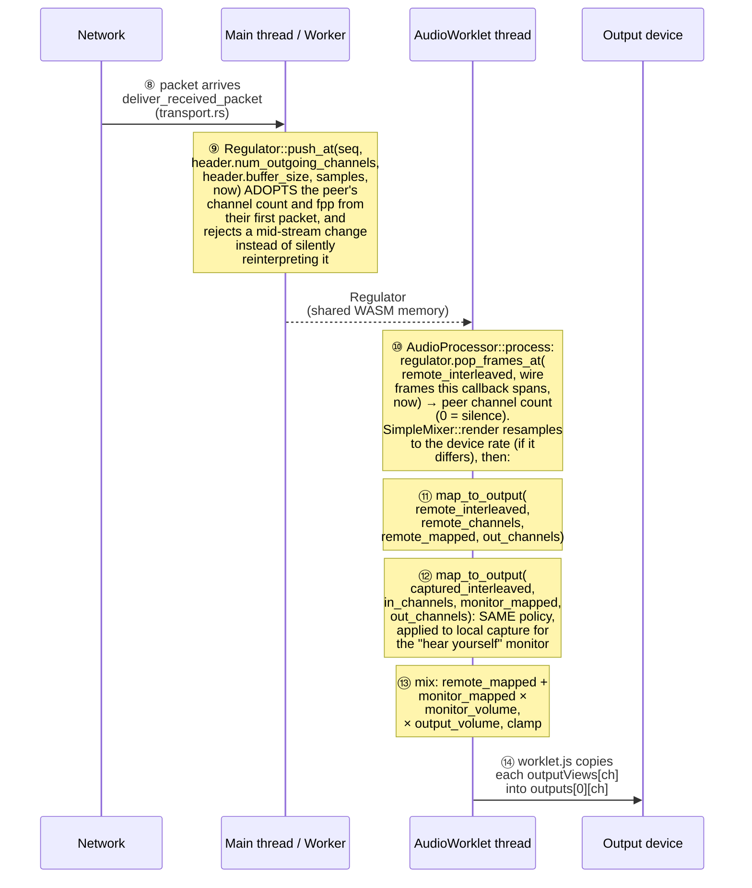

# WebTrip Channel Model

This document explains how WebTrip configures, discovers, and reconciles audio
**channel counts**: how many channels a client sends and asks back over the
network, how many input and output device channels it uses, and what happens
when those disagree with each other or with what the hardware and the peer
actually provide. It covers pre-connect configuration and device probing, and
the complete flow of audio from the input device through the network to the
output device.

For the broader threading model (why there's an AudioWorklet thread, a main
thread, and sometimes a WebTransport worker thread, and how they share
memory) see [architecture.md](architecture.md) — this document assumes that
context and focuses specifically on channels. For design rationale see
[`plans/channel-config.md`](../plans/channel-config.md) (and the earlier
[`plans/channel-model.md`](../plans/channel-model.md)) — but treat those as
historical background, not current documentation; per
[`plans/AGENTS.md`](../plans/AGENTS.md) the `plans/` directory isn't
guaranteed to reflect the code as it stands today. This document is.

---

## Table of Contents

1. [The Core Mental Model: Configured vs. Actual Channel Counts](#the-core-mental-model-configured-vs-actual-channel-counts)
2. [The Wire: Bytes 14 and 15](#the-wire-bytes-14-and-15)
3. [Before Connecting: Configuration and Probing](#before-connecting-configuration-and-probing)
4. [Connecting: Capture and Playback Setup](#connecting-capture-and-playback-setup)
5. [Send Path: Microphone → Network](#send-path-microphone--network)
6. [Receive Path: Network → Speakers](#receive-path-network--speakers)
7. [The Channel-Mapping Policy](#the-channel-mapping-policy)
8. [The Demo's Capture Modes](#the-demos-capture-modes)
9. [Key Invariants and Gotchas](#key-invariants-and-gotchas)
10. [File Map](#file-map)

---

## The Core Mental Model: Configured vs. Actual Channel Counts

**"How many channels" means several independent things**, and confusing them
is the source of most bugs in this area. None of them is required to equal any
other, and the code is written to tolerate all of them disagreeing at once.

A session has four **configured** counts. The wire counts (send/receive) are
set only while the network is `Idle` and are fixed for the life of a
connection; the device counts (input/output) are set only while audio is
stopped and are fixed while it runs. All four are retained across disconnects:

| Count | Default | Meaning | Setter (JS) |
|---|---|---|---|
| **Send** | 1 | Channels this client sends over the wire — every outbound packet's payload width | `setSendChannels` |
| **Receive** | 2 | Channels this client asks the peer to send back | `setReceiveChannels` |
| **Input** | 2 | How many of the input device's channels to capture — its first N | `setInputChannels` |
| **Output** | 2 | How many of the output device's channels to play to — its first N | `setOutputChannels` |

The wire counts (send, receive) have nothing to do with the devices. A client
can connect without probing any device at all, using the system default
devices. With the defaults, an unconfigured client captures the first two
input channels and mixes them down to mono to send.

At runtime three **actual** counts can differ from the configured ones:

| Actual count | Where it comes from | Where it lives |
|---|---|---|
| **Capture width** | The input count, clamped to what `getUserMedia` actually granted | `in_channels`, threaded through the worklet ABI into `AudioProcessor::process` |
| **Peer's send width** | Whatever the peer actually sends — the receive count is a request, not a guarantee | The `Regulator`'s adopted channel count (`regulator.channels()`), from the peer's first packet |
| **Output width** | The output count, clamped to the destination's `maxChannelCount` | `out_channels` passed to every `process()` call |

Two pure functions reconcile mismatches at each boundary:
[`conform_interleaved_channels`](#the-channel-mapping-policy) (capture width →
send count) and [`map_to_output`](#the-channel-mapping-policy) (peer's send
width → output width, and capture width → output width for the monitor mix).
Both implement the *same* mapping policy; they differ only in memory layout.

---

## The Wire: Bytes 14 and 15

Every JackTrip packet header (`protocol.rs`, `PacketHeader`, 16 bytes) carries
two channel fields, both named from the perspective of the packet's *sender*
(JackTrip's `DefaultHeader::fillHeaderCommonFromAudio`):

- **Byte 14, `NumIncomingChannelsFromNet`** — how many channels the sender
  receives from the network: the count it *wants back*. Senders write the
  receive count here.
- **Byte 15, `NumOutgoingChannelsToNet`** — how many channels the sender
  transmits: the channel count of *this packet's payload*. Senders write the
  send count here; receivers size and stride the payload by its decoded value
  (`deserialize_into`, and on the send side
  `total_packet_size_out`/`serialize_into`). It uses a compact encoding: `0`
  means "same as byte 14" (symmetric), `1`–`254` is an explicit count, and
  `255` means "no audio".

A JackTrip hub configures each client from its first packet: the client's
byte 14 becomes what the hub sends it, and its byte 15 what the hub expects
to receive.

`AudioPacket::serialize_samples_into(seq, ts, samples, send_channels,
receive_channels, buffer)` is the single place both transports build outbound
packets. With the defaults (send 1, receive 2) byte 14 is `2` and byte 15 is
`1`, which asks the hub for stereo while sending mono.

On receive, byte 14 must be `1`–`MAX_WIRE_CHANNELS` (`0` is rejected, as JackTrip
does), and byte 15 must decode to `0`–`MAX_WIRE_CHANNELS`. A "no audio" packet
(byte 15 = `255`, decoded `0`) passes header validation, but the regulator
then rejects it as `UnsupportedChannelCount`.

---

## Before Connecting: Configuration and Probing

### Probing devices

Device channel counts can be queried before any connection, with two
module-level async functions in `devices.rs`:

- **`getInputDeviceChannels(deviceId?)`** opens the device with `getUserMedia`
  (processing toggles off, `channelCount: {ideal: MAX_DEVICE_CHANNELS}`), reads the
  first track's `getCapabilities().channelCount.max` — falling back to
  `getSettings().channelCount` when capabilities are unavailable (Safari
  doesn't implement `getCapabilities`) — then stops the stream. The pure
  resolution, clamped to `[1, MAX_DEVICE_CHANNELS]`, is `resolve_input_channels`.
  It resolves to `undefined` when the browser reports neither (Safari).
- **`getOutputDeviceChannels(deviceId?)`** creates a throwaway `AudioContext`,
  routes it to the device via `setSinkId` when an id is given, reads
  `destination.maxChannelCount` clamped to `[1, MAX_DEVICE_CHANNELS]`, and closes the
  context. Without `setSinkId` (Safari, Firefox) it reports the default
  output, which is the device those browsers play to anyway.

They are free functions rather than `WebTripSession` methods because they
need nothing from a session: they probe hardware, independent of any
connection.

Probing is optional. The session's input/output counts are *upper bounds*
applied against the real devices at capture time, so an unprobed client with
the defaults still works on any hardware.

### Configuring the session

The four setters (`setSendChannels`, `setReceiveChannels`,
`setInputChannels`, `setOutputChannels`) share one guard,
`can_set_channel_count`: the count must be in `[1, MAX_WIRE_CHANNELS]` (send/receive) or
`[1, MAX_DEVICE_CHANNELS]` (input/output). The wire counts (send/receive)
are settable only while the network is `Idle`, the device counts
(input/output) only while audio is stopped. Otherwise the call logs a warning
and does nothing.

Both gates are deliberate. The transports snapshot the wire counts into
`AudioBufferConfig` at connect time, and the render thread reads the send
count from the connection's `RingBuffer::wire_channels`; changing either
mid-connection would desync the `RingBuffer`'s producer (the worklet) from its
consumer (the transport's send loop). The device counts size the capture and
the worklet node when audio starts, so they take effect on the next
`startAudio`.

The count reaches the render thread through the connection's send ring: each
connect builds a fresh `RingBuffer` and declares the send width on it
(`RingBuffer::set_wire_format`), so it is per-connection wire state and not part
of the device-wide `AudioParams`.

---

## Connecting: Capture and Playback Setup

### `connect()`

`WebTripSession::connect` builds `AudioBufferConfig { send_channels,
receive_channels, .. }` and hands it to the transport:

- **WebRTC** (`webrtc.rs`) sizes its send buffers from `send_channels` and
  passes both counts to `serialize_samples_into` on every tick.
- **WebTransport** (`webtransport.rs`) sends both to the worker in the init
  message (`sendChannels`, `receiveChannels`); the worker
  (`webtransport_worker.rs`) stores them in `WorkerState`, sizes its buffers
  from `send_channels`, and passes both to `serialize_samples_into` in
  `build_next_packet`.

### `AudioEngine::start_capture`

Once the transport is connected, the session starts capture with its input and
output counts (`engine.rs`):

1. Call `getUserMedia` with `channelCount: {ideal: MAX_DEVICE_CHANNELS}`
   (`AudioConstraints::to_js`). Asking for the maximum makes the browser open
   the device at its native width instead of downmixing, so "input channels =
   N" reliably means the device's first N.
2. Read the width the track **delivers** with `track_channels(…,
   resolve_granted_channels)`: the granted `getSettings().channelCount`,
   falling back to `getCapabilities().channelCount.max` only when settings
   are unreported. This is the
   reverse precedence of the probe (`resolve_input_channels`, capability
   first), because a node opened wider than the track delivers receives
   silent planes that the mono downmix averages in. Neither reported means 2.
3. Build the `AudioWorkletNode` with an input width of
   `min(input_channels, granted)`. The node's `channelCount` is
   `Explicit`/`Discrete`, so per the Web Audio spec the extra source channels
   are simply dropped. That is how an input count of 1 captures only channel 0.
   When the device is narrower than requested, the narrower width is used and
   the send path's conform fills the send width.
4. Route the context to the session's stored output device, if any
   (`route_output_sink`), before anything is connected to the destination, so
   playback never starts on the default output.
5. Configure the destination `Explicit`/`Discrete` at
   `min(output_channels, destination.maxChannelCount, MAX_DEVICE_CHANNELS)`
   (`configure_destination`). Setting a width above `maxChannelCount` throws.
   Because step 4 already ran, this is the selected device's
   `maxChannelCount`.

The engine keeps the worklet's input width and the requested output count, so
`set_output_device` can re-clamp the output against a new sink's
`maxChannelCount` and rebuild the node when the width changes.
`outputChannelCount`/`channelCount` are construction-time only on
`AudioWorkletNode`.

---

## Send Path: Microphone → Network

Key points:

- **Steps ①-⑥ happen on the AudioWorklet thread**, once per ~2.7ms render
  quantum (`RENDER_QUANTUM_FRAMES = 128` samples, `worklet.rs`).
- **`in_channels` is the real capture width this callback.** It flows from
  `worklet.js`'s `inputs[0].length` through `ProcessorHandle::render` into
  `AudioProcessor::process(input, in_channels, output, out_channels, now_ms)`
  (`processor.rs`), which hands the mixing to `SimpleMixer::render`
  (`mixer.rs`).
- **Step ⑤ is the one and only planar→interleaved conversion per callback.**
  `captured_interleaved` is shared by the send path and the local monitor mix
  on purpose. Converting twice would duplicate work and risk the two consumers
  drifting apart.
- **Step ⑥ is where the capture width and the send count meet.**
  The processor reads the connection ring's `RingBuffer::wire_channels()`,
  and the mixer pays for the conform only when `in_channels != send_channels`. This is how two
  captured channels are averaged into one sent channel, and how a mono capture
  against a stereo send is duplicated rather than mis-framed.
- **Step ⑦ happens on the main thread (WebRTC) or a dedicated worker
  (WebTransport).** See [architecture.md](architecture.md) for why network I/O
  can't run on the AudioWorklet thread. Both header channel fields come from
  `AudioBufferConfig`, never from what the worklet actually captured.

---

## Receive Path: Network → Speakers

Key points:

- **The receive count is a request.** It goes out in byte 14 of every packet,
  and a well-behaved hub sends that many channels back. But the regulator
  adopts whatever count the peer's first packet actually carries (step ⑨), and
  `map_to_output` handles any mismatch with the output width. Before that first
  packet, the connection's regulator has the shape it was built with at
  connect: the configured receive count and the session's `receive_fpp`. Each
  connection builds a fresh regulator, so a reconnect adopts the new peer's
  shape from scratch.
- **`out_channels` is the output width**, configured by
  `configure_destination`/`build_and_connect_worklet_node` and passed into
  every `process()` call.
- **Step ⑨'s soundness argument** (rebuilding channel-derived jitter-buffer
  state on the network thread while the audio thread may be mid-`pop`) is in
  `Shared::adopt_stream_shape`'s doc comment (`regulator.rs`).
- **Steps ⑪ and ⑫ use the exact same function**, `map_to_output`, applied to
  two different sources. That's why the mapping policy is documented once,
  below.
- **The destination is configured `Explicit`/`Discrete`**
  (`ChannelCountMode`/`ChannelInterpretation`, set in both
  `configure_destination` and `create_worklet_node_with_flag`) so the browser
  never folds or upmixes channels itself. All channel mapping is
  `map_to_output`'s job.

---

## The Channel-Mapping Policy

Two pure functions in `dsp.rs` implement **the same four-branch
policy** for reconciling a source channel count against a destination
channel count. They differ only in memory layout (one planar, one
interleaved), because their consumers need different layouts:

| Function | Source layout | Destination layout | Used for |
|---|---|---|---|
| `map_to_output(src, src_channels, out, out_channels)` | interleaved | **planar** (`out[ch*frames+frame]`) | Peer stream → output; local capture → monitor mix |
| `conform_interleaved_channels(src, src_channels, out, out_channels)` | interleaved | **interleaved** (`out[frame*out_channels+ch]`) | Capture width → send count |

The policy itself:

1. **`out_channels == 1`** → average every source channel down to one
   (delegates to `downmix_to_mono`).
2. **`src_channels == 1 && out_channels >= 2`** → copy the single source
   channel to destination channels 0 and 1; everything past channel 1 is
   silent.
3. **`src_channels == 2 && out_channels > 2`** → copy source channels 0/1 to
   destination channels 0/1; the rest silent.
4. **Otherwise** → 1:1 for `min(src_channels, out_channels)`; extra source
   channels are dropped, extra destination channels are silent.

There's also `interleave_planar` (planar → interleaved, used once per callback
to build `captured_interleaved`) and `max_channel_rms` (the level meter: the
*loudest* capture channel, not their average — a single hot channel among
quiet ones must still show on the meter).

---

## The Demo's Capture Modes

The demo (`website/src/pages/demo/Demo.tsx`) is one client of the model above.
It probes the selected devices on first render, whenever the selection
changes, and on `navigator.mediaDevices`'s `devicechange` event (which also
re-lists devices). Probes are skipped while the settings are locked (from the
start of a connect until the session is back to idle): counts only apply at
the next connect, and opening the input with `getUserMedia` beside a live
capture may disturb its track. A probe skipped while locked runs once the
session is idle again. It always asks for 2 receive channels, and uses 2 output
channels when the output device supports at least 2, otherwise 1. Connect
stays disabled until both probes have resolved. A probe that fails logs a
warning and assumes 2, since capture and playback still clamp to the real
device.

A 1-channel input device shows a locked "Mono". Otherwise a cycling button
picks between three modes, each just an (input, send) pair — the mixing falls
out of `conform_interleaved_channels`. Selecting a 1-channel device doesn't
overwrite the chosen mode, so switching back to a multi-channel device
restores it. Until you choose, the default is Mix to Mono, or Mono when the
browser reports no channel count.

| Mode | Input channels | Send channels | Mapping |
|---|---|---|---|
| Mix to Mono | 2 | 1 | 2 → 1 averages (rule 1) |
| Stereo | 2 | 2 | 1:1 (rule 4) |
| Mono | 1 | 1 | identity; the worklet node keeps only channel 0 |

The demo applies all four counts in `handleConnect`, right before
`connect`; Connect is only enabled while the session is `Idle`, so the
setters always take effect. So a remount never needs to re-sync the
module-singleton session. Connection and device settings are locked from
connect start until the session is back to idle; gain, volume, and monitor
stay live.

---

## Key Invariants and Gotchas

- **Wire and device counts are independent.** Nothing derives the send count
  from the input device or the receive count from the output device. The only
  links are the mapping functions at each boundary.
- **All four configured counts are fixed for a connection and retained after
  it.** Nothing narrows or rewrites them on disconnect. A device that turned
  out narrower than configured is handled by clamping at capture time, every
  time.
- **Payload width is the *decoded* byte 15.** Both serialize
  (`total_packet_size_out`, `serialize_into`) and deserialize stride the
  payload by `num_outgoing_channels`, as JackTrip's receivers do
  (`JackTrip::getPeerNumOutgoingChannels`). For a symmetric packet (byte 15 =
  `0`) that value comes from byte 14, so a receiver that sizes the payload from
  the raw byte 15 misreads it. WebTrip itself sends symmetric packets whenever
  the send and receive counts are equal (e.g. the demo's Stereo mode).
- **Chrome forces mono capture when echo cancellation is on.** This is a
  browser policy, not a WebTrip bug. The capture width drops to 1 and the
  conform fills the send width. If stereo capture looks unavailable during
  testing, check the AGC/Echo/Noise toggles first.
- **A browser reporting 0 channels is floored to 1** (`clamp_channel_count`),
  not surfaced as an error. Current browsers fail `getUserMedia` outright for
  an input with no channels rather than resolve with a degenerate track.
- **An unreported channel count is captured as 2.** If a track reports neither
  `getCapabilities().channelCount` nor `getSettings().channelCount` (Safari),
  the input probe resolves to `undefined` and capture opens up to 2 channels.
  Safari delivers two even for a mono microphone, with the second silent, so
  averaging them into one send channel halves the level; send 2, or set the
  input count to 1 to keep only the first. The demo defaults to the latter.
- **`RENDER_QUANTUM_FRAMES` (128) and `MAX_DEVICE_CHANNELS` (32) bound the
  worklet's planar scratch buffers** (`ProcessorHandle::input_scratch`/
  `output_scratch` in `worklet.rs`, sized `RENDER_QUANTUM_FRAMES *
  MAX_DEVICE_CHANNELS`). `worklet.js` reads both from the handle
  (`channel_capacity()`, `frames_per_quantum()`) rather than keeping copies.
  The device-width scratch in `SimpleMixer` (`mixer.rs`: `gained`,
  `captured_interleaved`, `remote_mapped`, `monitor_mapped`) is preallocated
  by `prepare` at `RENDER_QUANTUM_FRAMES * MAX_DEVICE_CHANNELS`. The
  wire-width buffers in `processor.rs` (`remote_interleaved`, `wire_staging`)
  are preallocated at `wire_frames_per_callback(RENDER_QUANTUM_FRAMES,
  device_rate, wire_rate) * MAX_WIRE_CHANNELS`, so no resize allocates on the
  real-time render thread.
- **Two ceilings.** A device is addressed up to `MAX_DEVICE_CHANNELS` (32);
  the wire carries at most `MAX_WIRE_CHANNELS` (8) — a WebTrip choice that
  keeps packets within one unfragmented datagram. Both live in
  `webtrip_core::limits`. Captured audio wider than the wire is conformed
  down on send; peers wider than the output device are mapped on receive.

---

## File Map

| Concern | File |
|---|---|
| Session channel configuration (send/receive/input/output setters, network-idle and audio-stopped guards), `AudioBufferConfig` construction | `crates/web/src/session.rs` |
| Per-connection send ring and regulator (`StreamBuffers`), built at the configured counts | `crates/web/src/connection.rs` |
| `AudioBufferConfig` (send/receive counts handed to transports) | `crates/core/src/network/transport.rs` |
| Per-connection send width (`RingBuffer::set_wire_format`/`wire_channels`) | `crates/core/src/stream/ring_buffer.rs` |
| Pre-connect device probes (`getInputDeviceChannels`, `getOutputDeviceChannels`), `resolve_input_channels` | `crates/web/src/audio/devices.rs` |
| `getUserMedia` constraints, capture-width clamping, destination configuration, worklet node (re)building | `crates/web/src/audio/engine.rs` |
| Worklet ABI (planar scratch buffers, `ProcessorCallback`/`ProcessorHandle::render`) | `crates/web/src/audio/worklet.rs` |
| Worklet JS bridge (copies each channel plane in/out of WASM memory) | `crates/web/src/audio/worklet.js` |
| Gain, metering, planar↔interleaved conversion, channel-mapping policy, rate conversion (`StreamResampler`) | `crates/core/src/audio/dsp.rs` |
| Composing those into one callback's send and monitor/peer mix (`SimpleMixer`) | `crates/core/src/audio/mixer.rs` |
| Ring/regulator pointer work, send/receive wiring | `crates/core/src/audio/processor.rs` |
| Wire protocol header (bytes 14/15, payload sizing) | `crates/core/src/network/protocol.rs` |
| Peer channel-count adoption (jitter buffer) | `crates/core/src/stream/regulator.rs` |
| Per-transport packet framing at the send/receive counts | `crates/web/src/network/webrtc.rs`, `crates/web/src/network/webtransport.rs`, `crates/web/src/network/webtransport_worker.rs` |
| Demo UI: probing, `devicechange`, capture modes, config locking | `website/src/pages/demo/Demo.tsx` |
